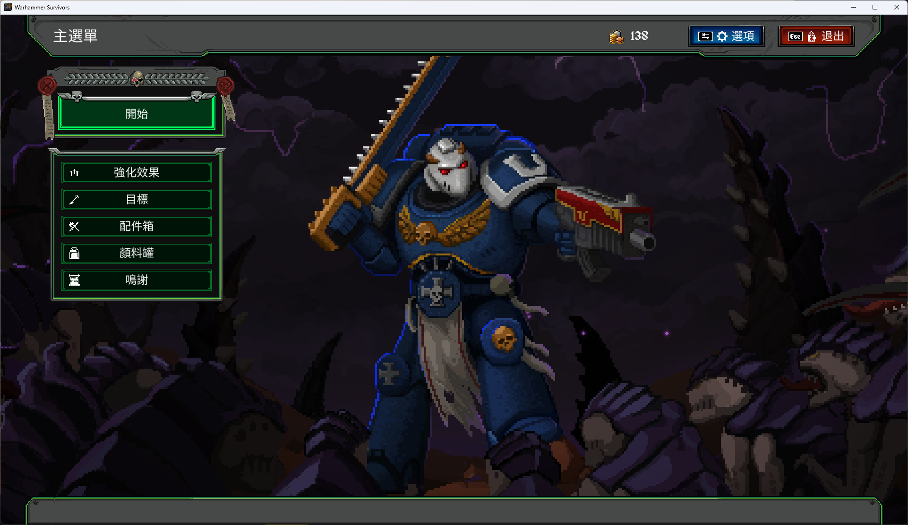

# Warhammer Survivors 繁體中文模組

將遊戲內的簡體中文轉成繁體中文（使用 OpenCC S2TW 與內嵌自訂詞彙）。



## 適用環境

- **平台**：Windows
- **框架**：BepInEx 6 IL2CPP（BepInEx 前沿版本 #785）
- **測試的遊戲版本**：2.1.6
- **遊戲語系**：需設定為「簡體中文」

## 功能

- **快取**：首次啟動時自動轉換並快取至模組 DLL 旁的 `_cache/_translate.json`，避免重複轉換影響效能。
- **無修改**：僅處理簡體中文文本，其餘核心功能不做任何修改。
- **自動版本偵測**：當遊戲版本變更時會自動重建快取，理論上適用於未來更新。

## 安裝方式

1. 安裝 BepInEx 6 IL2CPP。（發布頁面已整合 BepInEx 前沿版本 #785）
2. 將模組解壓縮至遊戲目錄。
3. 進入遊戲並將語系設定為「簡體中文」，將會自動完成轉換。
4. 若轉換不完全，請刪除 `_cache` 資料夾並重新啟動遊戲。

## 從原始碼建置

### 手動編譯

```powershell
dotnet build .\src\TraditionalChinese\TraditionalChinese.csproj -c Release "-p:GameRoot=<GameDir>\Warhammer Survivors"
```

編譯完成後，只需取出以下檔案：

```text
├─ WarhammerSurvivors.TraditionalChinese.dll
└─ THIRD_PARTY_NOTICES.md
```

### 最終安裝目錄

請自行新增 `TraditionalChinese` 資料夾，並將上述檔案放入：

```text
BepInEx/plugins/TraditionalChinese/
├─ WarhammerSurvivors.TraditionalChinese.dll
└─ THIRD_PARTY_NOTICES.md
```

## Credit

此模組使用 AI 輔助建置。
- [BepInEx](https://github.com/BepInEx/BepInEx) — 依賴
- [OpenCC](https://github.com/byvoid/opencc) — 採用 Apache-2.0 授權。